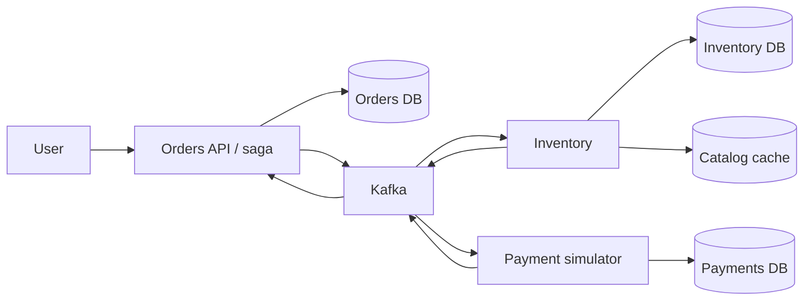

# Student Checkout Lab

A small learning project for **transactions, asynchronous events, idempotency, a checkout saga and caching**. Each example is meant to be read, run, broken and explained. One product per order; simulated approve/decline payments; three services.

This is a Python rebuild on branch `student-checkout` of the existing productservice repository. The earlier Java catalog project is preserved in [legacy/java-productservice](legacy/java-productservice/). It is not needed to run this lab. This rebuild is dated November 2026 and was implemented with assistant help; code completion does not imply the learner has already studied every concept.

## Start

[Recorded validation](docs/VALIDATION.md): 15 real integration checks, three controller HTTP-contract checks, and two real outage demos passed. Public API contracts are unchanged.

Requirements: Docker-compatible runtime with Compose, Python 3.13, and about 3 GiB available for the local container VM. On this Mac the dedicated runtime is Colima profile `placement-lab`; elsewhere Docker Desktop or an ordinary Linux Docker installation works.

```sh
python3 -m venv .venv
.venv/bin/python -m pip install -r requirements.txt
python3 tools/dev.py up
.venv/bin/python tools/demo.py
```

If the dedicated VM is stopped, start it with `colima start placement-lab` before bringing up the project. To release its memory after practice, first run the project's `down` command, then `colima stop placement-lab`.

The helper automatically uses `colima-placement-lab` when that Docker context exists, without changing your global default. An explicit `DOCKER_CONTEXT` overrides it.

Open [Orders Swagger UI](http://localhost:8000/docs), [Inventory Swagger UI](http://localhost:8001/docs) or [Payments health](http://localhost:8002/health).

Try an order:

```sh
curl -X POST http://localhost:8000/orders \
  -H 'Content-Type: application/json' \
  -H 'Idempotency-Key: my-first-order' \
  -d '{"product_id":1,"quantity":1,"payment_outcome":"approve"}'
```

The response is **202 Accepted**, initially PENDING, with a Location header. Read `GET /orders/{id}` until COMPLETED/CANCELLED. Repeating the same body/key returns the same order; changing the body with that key returns 409. To see compensation, use a **new key** and `"payment_outcome":"decline"`.

Money is stored as integer paise: 19900 means INR 199.00. The service reads the price from inventory, not from the request. `X-Demo-Customer` defaults to `student`; it is a teaching identity header, **not authentication**.

## Understand the structure

```text
services/
  orders/       # API, idempotency and saga state transitions
  inventory/    # Catalog, atomic stock updates and compensation
  payments/     # Deterministic simulated charge ledger
common/         # Small DB transaction and Kafka outbox/inbox helpers
infra/          # Local database creation
tests/         # Actual DB/broker integration and failure scenarios
tools/         # Start, demo and test commands
legacy/        # Original Java project
```

Inside each HTTP-facing service, responsibilities are separated with ordinary functions:

```text
services/orders/
  app.py               # Startup wiring; include the HTTP router
  controller.py        # Headers, validation boundary, HTTP status/response
  schemas.py           # Pydantic request schema
  service.py           # Order use cases, saga and transaction ownership
  repository.py        # SQL functions using the supplied connection
  inventory_client.py  # HTTP adapter for the authoritative price lookup
  schema.sql           # Table definitions and constraints
```

Inventory uses the same controller/service/repository split. Payments is event-driven and exposes only the shared health endpoint, so it has app/service/repository files and no empty business controller.

Controllers do not issue SQL. Repositories do not open or commit transactions. A service passes **one connection** to all repositories and outbox/inbox operations that must commit together. Kafka consumers call the same service layer; transport code commits its offset only after the service transaction succeeds.

Each service owns a separate PostgreSQL database and role. Local Compose hosts them in one PostgreSQL instance. Services communicate through HTTP/Kafka, not cross-database queries.



Success: **PENDING → RESERVED → PAID → COMPLETED**.

Decline: **PENDING → RESERVED → COMPENSATING → CANCELLED**. The order is cancelled only after inventory release is acknowledged.

Sold out: **PENDING → CANCELLED**, with no payment operation.

## Learn one concept at a time

1. **Transactions:** each `service.py` owns its use-case transaction through `common/db.py`; repository functions share that connection.
2. **Concurrency:** `services/inventory/service.py` chooses the reservation operation; `repository.py` performs its conditional UPDATE.
3. **Request idempotency:** `services/orders/service.py` implements the use case; its repository relies on the unique customer/key constraint.
4. **Events:** `common/events.py` and `common/bus.py`. Kafka carries commands/results keyed by order ID.
5. **Outbox/inbox:** `common/repository.py` persists messaging records on that same connection; a business change and its outgoing event share a DB transaction. Delivery can repeat; inbox receipt and business effect share the receiving transaction. Consumer offsets commit afterwards.
6. **Saga/compensation:** `services/orders/service.py` chooses the next command; inventory release compensates a declined payment.
7. **Caching:** `/products` caches catalog metadata for 30 seconds. Stock and the order's price lookup stay authoritative. Redis failure falls back to PostgreSQL.

The publisher deliberately holds one outbox row lock while waiting briefly for Kafka's acknowledgement. This keeps the learning example small. There is one consumer/publisher thread per service, simple retries and readable logs. It is not a high-throughput relay or a production deployment design.

## Run checks and failure demonstrations

```sh
python3 tools/dev.py test
python3 tools/dev.py failure-demo
python3 tools/dev.py logs
python3 tools/dev.py down
```

Normal tests include three isolated controller-error checks and real-infrastructure cases covering successful checkout, decline compensation, sold-out orders, concurrent duplicate keys, customer/key scoping, twenty buyers for one unit, duplicate Kafka deliveries, duplicate business operations with new event IDs, transaction rollback, input validation and caching.

`failure-demo` briefly stops **this project's** Kafka/Redis containers, verifies durable pending orders/recovery and cache fallback, then restarts them in cleanup. Run it separately from ordinary tests. `down` preserves the project's PostgreSQL data. To deliberately reset all learning data, select this project's Docker context and run `docker compose down -v`. PostgreSQL and Kafka each have persistent local volumes; Redis is a disposable cache.

## Learning scope and limits

There is no real money, card data, public deployment, production login, multi-item cart, refund flow, uncertain-provider reconciliation, reservation expiry or automated dead-letter queue. Those are optional later lessons. A malformed/unsupported broker event is logged and retried; the sample does not claim comprehensive poison-message recovery.

A Kafka outage may leave a PENDING order until recovery. There is no automatic cancellation deadline in this small version. Decline is deterministic, so ambiguous/late external payment outcomes are not simulated. Local broker/database instances are single points of failure. No commercial readiness, distributed exactly-once, throughput or p95 claim is made.

[Design decisions](docs/DESIGN.md) explain the trade-offs and extension ideas. Personal interview walkthroughs and learning progress are kept outside this repository in the placement workspace's `interview-prep/ecommerce/` folder.
